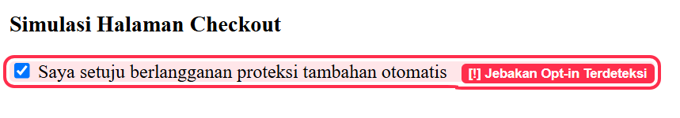

# DarkPattern Shield

Ekstensi browser ringan berbasis Manifest V3 untuk mendeteksi dan menyorot praktik *dark pattern* secara otomatis pada halaman web, khususnya kotak centang (*pre-checked opt-in*) dan biaya langganan tersembunyi saat proses *checkout* atau pendaftaran akun.

## Masalah yang Diselesaikan
Banyak situs web dan layanan digital menggunakan trik antarmuka (*dark patterns*) seperti mencentang opsi asuransi tambahan atau perpanjangan langganan otomatis tanpa disadari pengguna. **DarkPattern Shield** memindai elemen halaman secara lokal di sisi klien (*client-side*) untuk memberi peringatan visual instan sebelum pengguna melakukan transaksi.

## Fitur Utama

 

- **Auto-Detection Pre-Checked Opt-In:** Memindai `input[type="checkbox"]` yang sudah tercentang otomatis dan mencocokkannya dengan kata kunci jebakan langganan, asuransi, atau biaya tersembunyi.
- **Dynamic DOM Monitoring:** Menggunakan `MutationObserver` untuk tetap mendeteksi elemen jebakan pada situs modern berbasis *Single Page Application* (SPA) yang memuat konten secara dinamis.
- **Zero-Server & Privacy-First:** Seluruh pemindaian berjalan 100% di browser pengguna tanpa mengirim data halaman ke server eksternal mana pun.

## Teknologi yang Digunakan
- JavaScript (ES6+ / DOM Manipulation / MutationObserver)
- Chrome Extension Manifest V3
- HTML5 & CSS3

## Cara Instalasi Lokal (Developer Mode)
1. Clone atau unduh repository ini ke komputer lokal.
2. Buka browser berbasis Chromium (Google Chrome atau Microsoft Edge) dan akses `chrome://extensions/` atau `edge://extensions/`.
3. Aktifkan **Developer mode** di pojok kanan atas.
4. Klik **Load unpacked** dan pilih folder `anti-dark-pattern-ext`.

## Rencana Pengembangan (Roadmap)
- [ ] Penambahan tombol *Auto-Uncheck* satu klik untuk membatalkan semua jebakan yang terdeteksi.
- [ ] Penghitung jumlah jebakan yang diblokir pada jendela `popup.html`.
- [ ] Deteksi tombol pembatalan langganan (*unsubscribe*) yang disembunyikan dengan kontras warna rendah.

## Dukungan & Kontribusi
Jika alat ini membantu melindungi transaksi harian Anda, silakan beri bintang (Star) pada repository ini atau dukung pengembangan fitur lanjutan melalui tautan donasi di profil GitHub ini.
